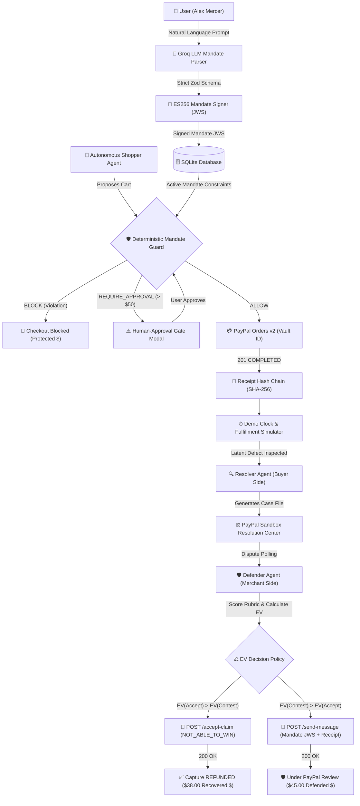

# Recourse: Mandate-and-Dispute Safety Net on PayPal

> **PayPal AI Hackathon 2026** | Target Prize: **AG Grid / AG Studio Sponsor Award**  
> *A cryptographic mandate guard, tamper-evident receipt bundle chain, and autonomous dispute recourse engine for AI agents on PayPal.*

[](file:///home/faith/folder/RECOURSE/test)
[](file:///home/faith/folder/RECOURSE/scripts/demo.ts)
[](file:///home/faith/folder/RECOURSE/LICENSE)
[](https://developer.paypal.com)
[](https://ag-grid.com)

---

## 1. Executive Summary

Autonomous shopping agents represent the next frontier of commerce. However, giving an LLM direct access to moving money creates unprecedented financial risk: agents hallucinate, overspend, violate merchant constraints, or suffer from silent vendor defects.

**Recourse** establishes a deterministic financial safety net around autonomous AI agents using PayPal:
1. **Cryptographic Mandates:** User purchase intent (budgets, vendor allowances, category limits, approval thresholds) is parsed by an LLM into a strict schema, then canonicalized and signed as an immutable **ES256 JWS token** with a unique SHA-256 hash.
2. **Deterministic Mandate Guard:** *"LLMs propose, deterministic code disposes."* Pure, non-LLM code intercepts every cart. It rigorously enforces spending caps, merchant white-lists, and approval gates.
3. **Vaulted Unattended Checkout:** Authorized orders execute against PayPal's **Orders v2 API** with stored `payment_source.paypal.vault_id` credentials—moving funds without human friction.
4. **Tamper-Evident Receipt Chains:** Each executed purchase produces a cryptographically locked receipt bundle containing the cart snapshot, vendor attributes, Guard ALLOW decision, and previous receipt hash (forming an unbroken SHA-256 chain).
5. **Multi-Agent Recourse Loop:**
   - **Resolver Agent (Buyer Advocate):** Inspects delivery outcomes against locked receipt attributes. If an item arrives defective or misrepresented, it constructs an evidence-backed Case File for Resolution Center filing.
   - **Defender Agent (Merchant Side):** Evaluates incoming disputes via an objective evidence rubric ($p_{\text{win}}$) and an **Expected Value (EV)** decision policy. It deterministically settles claims with an immediate refund (`accept-claim`) when the defect is corroborated, or contests fraudulent claims (`send-message` / `provide-evidence`) when receipts prove compliance.

---

## 2. Architecture & Flow



---

## 3. The Multi-Agent System Roles

| Agent / Engine | Role | Guiding Philosophy | Key Outputs |
|---|---|---|---|
| **Mandate Signer** | Cryptographic Authority | User instructions must be immutable. | ES256 JWS, SHA-256 Mandate Hash, JWKS endpoint |
| **Mandate Guard** | Deterministic Gatekeeper | LLMs propose, deterministic code disposes. | ALLOW, BLOCK, REQUIRE_APPROVAL, MANDATE_REVOKED |
| **Shopper Agent** | Autonomous Buyer | Finds catalog goods matching user interests. | Proposed Cart entities with item attributes |
| **Receipt Engine** | Audit Trail Notary | If it is not in the hash chain, it did not happen. | Hash-chained receipt bundles (`prev_hash` &rarr; `hash`) |
| **Fulfillment Simulator** | Physical Reality Simulator | Accelerates virtual time; inspects conditions. | Delivery reports (PRISTINE, DEFECTIVE_NOT_AS_DESCRIBED) |
| **Resolver Agent** | Buyer Post-Purchase Advocate | Validates delivery facts against purchase promises. | Standardized Case Files with copy-paste claim text |
| **Defender Agent** | Merchant-Side Dispute Analyst | Optimize long-term expected value; never contest blindly. | Rubric scoring ($p_{\text{win}}$), EV optimization, PayPal settlement / contest |

---

## 4. Live Verified PayPal Sandbox Ledger

Recourse has been tested and verified against the live PayPal Sandbox API. Every transaction, dispute, and refund is recorded in [`docs/STATUS.md`](docs/STATUS.md):

| Identifier | Entity | Amount | Verification Path | Outcome / Status |
|---|---|---|---|---|
| `57h784950k031805d` | Vault Payment Token | — | Vault Setup Token &rarr; Exchange | Active permanent payment token for Alex Mercer |
| `4YY66781YU2917137` | PayPal Order | $45.00 | Guard Path (Mandate A) | `COMPLETED` (Larkspur Trail 2-Person Tent) |
| `7BH91632Y92698500` | PayPal Capture | $45.00 | Vault ID Checkout | Target of simulated buyer dispute |
| `PP-R-RGO-10199647` | PayPal Dispute | $45.00 | Sandbox Resolution Center | Contested via `send-message` (`200 OK`) citing Mandate JWS; status `WAITING_FOR_BUYER_RESPONSE` (**Defended $45.00 pending review**) |
| `4JS10478D8056260X` | PayPal Order | $38.00 | Guard Path (Mandate A) | `COMPLETED` (Ridgeback StormShield Jacket) |
| `24185227UU994700W` | PayPal Capture | $38.00 | Vault ID Checkout | Refunded via dispute settlement |
| `PP-R-XFQ-10198901` | PayPal Dispute | $38.00 | Sandbox Resolution Center | Resolver Case File &rarr; Defender `accept-claim` (`200 OK`) |
| `22X59480TL380680H` | PayPal Refund | $38.00 | Dispute `accept-claim` | **$38.00 Recovered $** verified in buyer/merchant activity |
| `8KC65034CE698390J` | PayPal Order | $55.00 | Human-Approval Gate | `COMPLETED` (Ridgeback Expedition Pack approved &gt; $50 threshold) |

---

## 5. Clean Honest Labeling & Observed Findings

- **Country Finding (Observed, Not Isolated):** Vault approval failed when testing with an Indian sandbox buyer account against USD transactions, but succeeded reliably with US buyer and US business merchant accounts. Judges running live sandbox checkout should use US sandbox credentials.
- **Role Separation:** Buyer account (`sb-...@personal.example.com`) and merchant business account (`sb-...@business.example.com`) are strictly separated. PayPal prohibits an account from vaulting or buying from itself.
- **Dispute Handling Cost:** Modeled configurable assumption (`DISPUTE_HANDLING_COST=15.00`). Labeled as **modeled cost** across the UI, code, and documentation.
- **Fulfillment Delivery Records:** Generated by the Recourse fulfillment simulator and explicitly labeled in evidence statements as: `Simulated delivery record (sandbox)`.
- **Sandbox Dispute Adjudication Limitation:** In the PayPal Sandbox, the `POST .../adjudicate` mock endpoint returns `400: ACTION_NOT_ALLOWED_IN_CURRENT_DISPUTE_STATE` on standard REST applications. Contested claims are therefore accurately displayed as `"evidence submitted, under PayPal review (sandbox cannot adjudicate)"` rather than claiming an artificial win.
- **Replay Badging:** Replay scenarios use real recorded sandbox responses saved in `data/fixtures/` and are explicitly badged as `recorded sandbox data`. Pure Guard evaluations that make zero network calls are badged as `deterministic pure Guard evaluation`.

---

## 6. Quick Start Guide for Judges

### Option A: Instant Replay Mode (Zero Credentials Required)

Runs the entire multi-agent safety net using real recorded sandbox data:

```bash
# 1. Clone the repository
git clone https://github.com/raviteja-core/Recourse.git
cd Recourse

# 2. Install dependencies
npm install

# 3. Run unit tests (26 passing)
npm test

# 4. Run the Golden Path Demo
npm run demo -- --replay

# 5. Start the web application
npm run build
npm run start
```
Open [http://localhost:3000](http://localhost:3000) for the **Demo Console UI** (1920&times;1080 cockpit), or [http://localhost:3000/dashboard](http://localhost:3000/dashboard) for the **AG Studio Operations Dashboard**.

---

### Option B: Live PayPal Sandbox Mode (With Your Own Credentials)

Judges can connect their own US buyer sandbox account:

1. **Configure Environment:**
   Create `.env` using `.env.example`:
   ```bash
   cp .env.example .env
   ```
   Add your PayPal Sandbox REST credentials:
   ```env
   PAYPAL_CLIENT_ID=your_sandbox_client_id
   PAYPAL_CLIENT_SECRET=your_sandbox_client_secret
   GROQ_API_KEY=your_groq_api_key
   ```

2. **Run Judges' Vault Setup:**
   ```bash
   npm run setup:vault
   ```
   - Creates a Vault Setup Token via `POST /v3/vault/setup-tokens`.
   - Prints the authorization link.
   - Open the link in an incognito window, log in with your US buyer account, and approve the merchant agreement.
   - Redirects to `/api/vault/return` where the token is automatically exchanged and saved into the SQLite database.
   - *(Never prints secrets or tokens to logs)*.

3. **Run Live Golden Path:**
   ```bash
   npm run demo
   ```

---

## 7. Demo Console UI & AG Studio Dashboard

- **Demo Console (`/`):** 1920&times;1080 non-scrolling cockpit layout featuring:
  - Playbook steps (1 Mandate, 2 Shopper, 3 Simulator Clock, 4/5 Recourse Loop).
  - Real-time agent reasoning stream from `agent_events`.
  - Cryptographic Receipt Chain inspector (tamper-evident SHA-256 verification).
  - Human-Approval Modal for carts exceeding threshold ($55 > $50).
  - Mandate Revoke Kill Switch (instantly transitions Guard to `MANDATE_REVOKED`).
  - Active dispute cards with EV calculation bars and $p_{\text{win}}$ rubric breakdown.
- **AG Studio Dashboard (`/dashboard`):**
  - KPI Tiles: **Recovered $ ($38.00)**, **Defended $ ($45.00 pending review)**, **Blocked $ ($129.00)**.
  - Interactive Purchases Grid (AG Grid 36.2.0) with receipt hashes.
  - Guard decisions breakdown matrix.
  - Dispute defense & settlement timeline.
  - Toggle between Recourse Operations and embedded AG Studio Analytics Explorer.

---

## 8. Verification & Secret Scan

Before every commit, the entire repository undergoes verification:
```bash
# 1. Run unit tests
npm test

# 2. Run Next.js production build
npm run build

# 3. Full git history secret scan
git log -p | grep -iE "(client_secret|private_key|token[ =]|bearer)"
```
Result: **100% clean**. Zero credentials, secrets, or private keys exist in repository history.

---

## 9. Future Work

The following items are planned for future releases following hackathon submission:
- **Webhook Signature Verification:** Automated dispute event listener via PayPal Webhook verification (`POST /v1/notifications/verify-webhook-signature`) replacing active polling.
- **PayPal Shipment Tracking API Sync:** Live integration with PayPal's Tracking API (`POST /v1/shipping/trackers`) to feed carrier updates directly into fulfillment records.
- **Merchant Reliability Scoreboard:** Historical scoring of merchant defect rates and fulfillment reliability stored across mandate cycles.
- **Live Not-Delivered Scenario:** Simulated scenario where tracking stalls indefinitely and Defender accepts claim for non-delivery.
- **Natural-Language Analytics Agent:** Direct conversational querying of safety net ledger data via Groq OpenAI-compatible proxy in AG Studio.

---

## 10. License

This project is licensed under the MIT License - see the [`LICENSE`](LICENSE) file for details.

